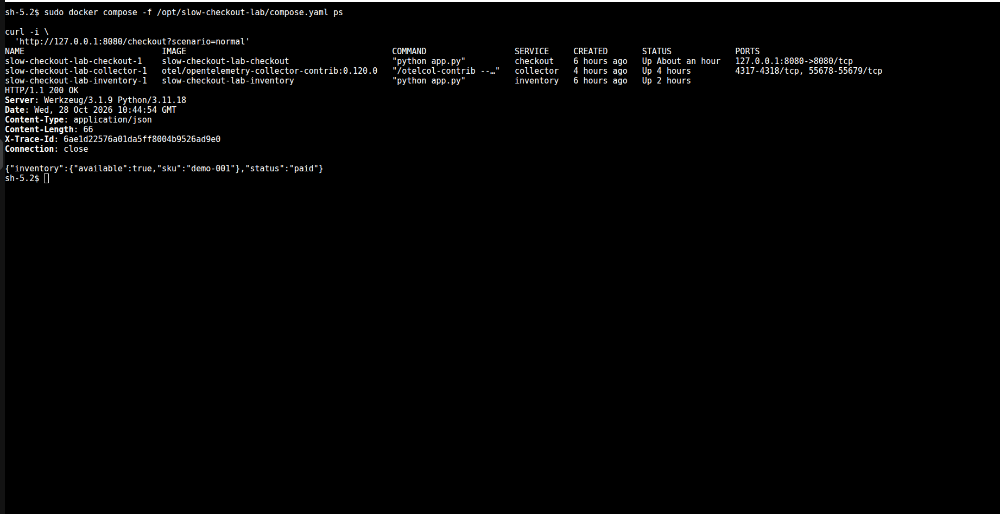
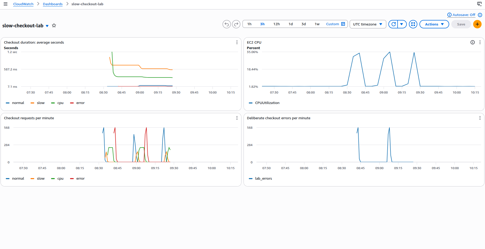
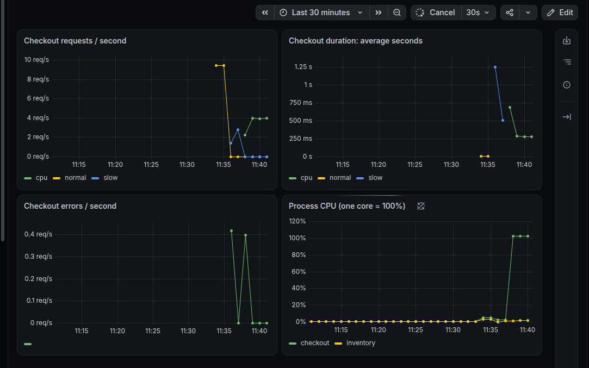
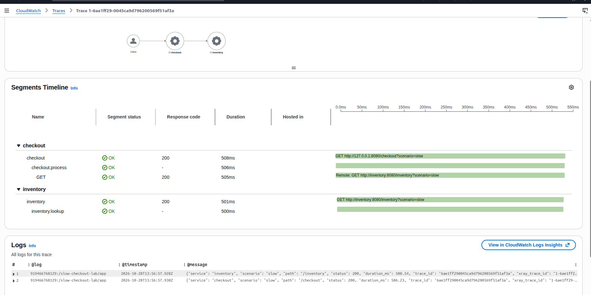
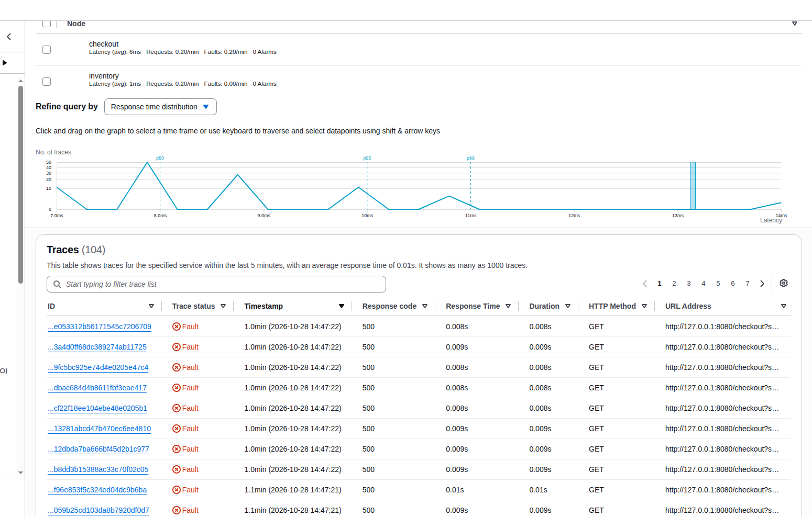
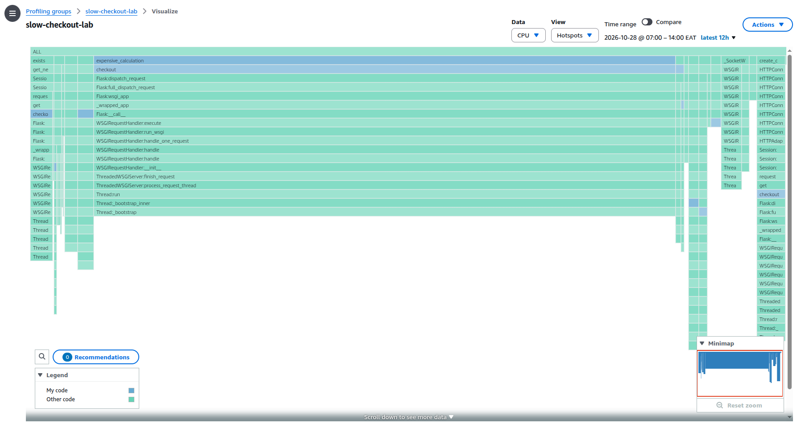
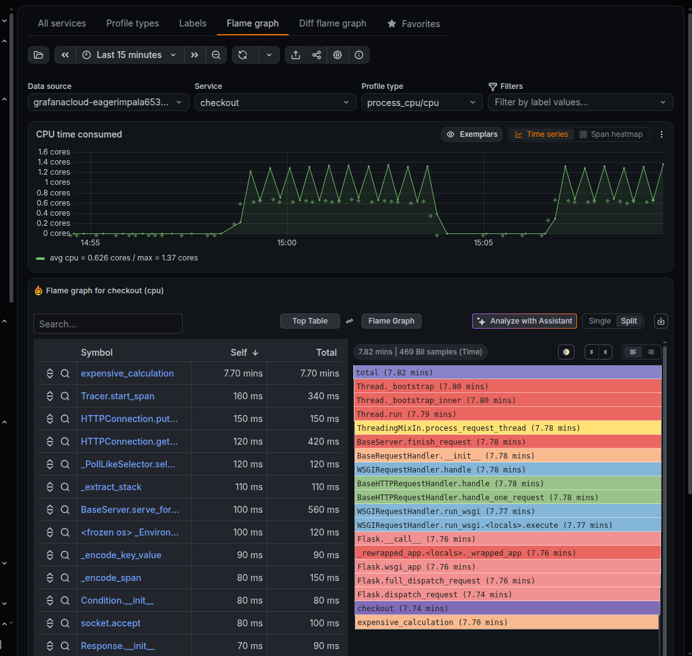

## Running Application

Terminal showing all three containers running and a successful checkout response.

## AWS Dashboard

AWS  and Grafana receive application and infrastructure metrics

## Slow Distributed Trace

Inventory adds a deliberate 500 ms delay.The trace places the delay Inventory is responsible for the increased checkout latency.

## Correlated Failure

An error log with its trace ID and the matching error trace	Logs and traces can be connected to investigate a failed request

## Profile Hotspot

CodeGuru and grafana flame graph highlighting expensive_calculation, Profiling identifies the deliberately expensive function

